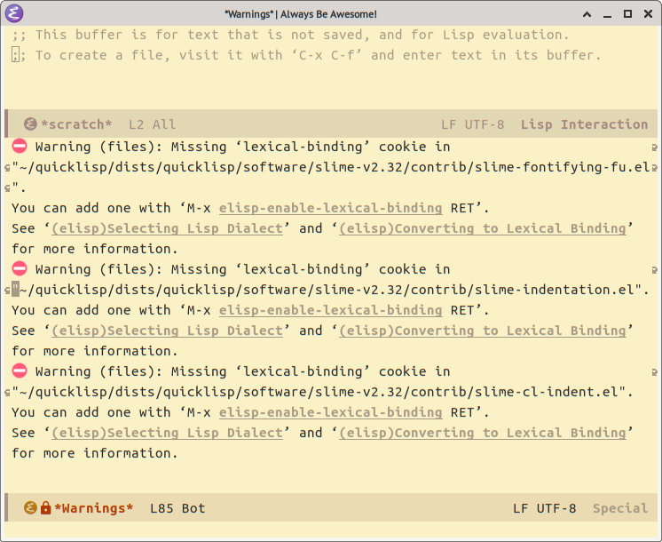

= Lexical Binding Error in Emacs 31.1
:page-subject: Emacs

== The problem

Starting with Emacs 30.1, many users started seeing this error:

That is because a future version of emacs will switch the default dynamic binding to lexical binding.
It will still be configurable, but the default will change, and will mostly likely require code changes, so Emacs is already “forcing” users be aware of it and asking them to handle the situation.

== Solution

Read the error and see which files have the error, and then add this local variable line the very first line of each file that causes the error:

[source,elisp]
----
;; -*- lexical-binding: nil -*-
----

See link:https://emacs.stackexchange.com/questions/85745/how-to-totally-and-completely-remove-the-no-lexical-binding-warning[this Emacs Exchange thread] for further info and command line scripts to add the local variable line in a more automated way.
I used this one (from an answer on that thread):

[source,bash]
----
find "${@:-.}" -type f \
     \( -name ".dir-locals*" -o -name "*-pkg.el" \) -prune \
     -o -name "*.el" -print0 \
    | xargs -0r -L1 sed -n -e '1{/\blexical-binding\b/!F}' \
    | tr '\n' '\0' \
    | xargs -0r emacs -Q --batch --eval '(add-hook (quote find-file-hook)
      (lambda ()
        (when (eq major-mode (quote emacs-lisp-mode))
          (let* ((prop-vars (hack-local-variables-prop-line))
                 (cookie (assq (quote lexical-binding) prop-vars)))
            (unless cookie
              (message "%s" buffer-file-name)
              (add-file-local-variable-prop-line (quote lexical-binding) nil)
              (save-buffer))))))' --
----

Also had to add it to my `init.el` file.