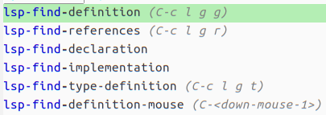
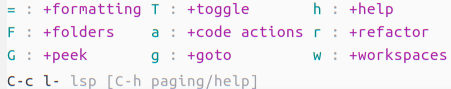

= My Emacs Workflow
:page-subject: emacs
:experimental:

== Intro

These are notes (mostly for myself) on how I go about doing actual work in Emacs, like how I find stuff, modify, jump around, etc.

[NOTE]
====
These notes relates to my Emacs config, my keybindings and which packages I have installed and how they are configured.
====

== Projectile!

=== Search for text

Use kbd:[C-c p s] to get search-related which-key suggestions.

== Navigate to next and previous git/diff hunks

=== diff-hl package

* kbd:[C-x v []: `diff-hl-next-hunk`.
* kbd:[C-x v \]]: `diff-hl-previous-hunk`.
* kbd:[C-x v }]: `diff-hl-show-hunk-next`.
* kbd:[C-x v {]: `diff-hl-show-previous-hunk`.

== Language servers (LSP)

Lsp-mode integrates with Flymake (since it is built into Emacs) to show LSP diagnostics on the minibufer.
Flycheck is another option.

* kbd:[M-n]: `flymake-goto-next-error`.
* kbd:[M-p]: `flymake-goto-prev-error`.

Other LSP-related keymaps are prefixed with kbd:[C-c l].
From there, further keys are possible for code actions, goto definitions/references/etc., and others.

For example, kbd:[C-c l g g] is `lsp-find-definition`.
kbd:[M-x lsp-find] shows this for me in the vertico buffer:

And `which-key` results after typing kbd:[C-c l] to see available keymaps for LSP:

